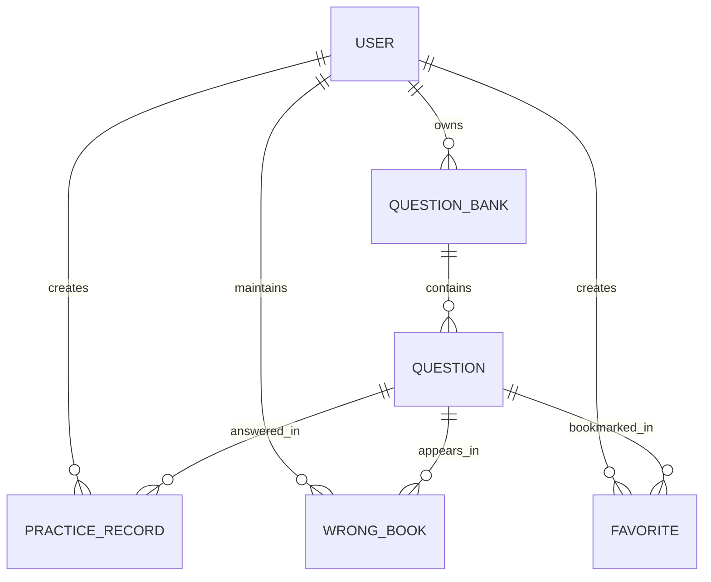

# DocQuiz 数据库概念设计

> 版本：V2.0  
> 对应代码基线：2026-10-31  
> 本文描述业务实体及实体关系；字段类型、约束和 ORM 映射见《数据库设计说明.md》。

## 1. 设计原则

1. 用户数据隔离：题库属于创建者；练习记录、错题和收藏属于具体用户。
2. 题目独立于练习记录：题目保存标准内容，用户每次作答形成独立记录。
3. 错题与收藏是用户和题目之间的关联实体，附带各自业务属性。
4. 同一用户对同一道题最多有一条当前错题记录和一条收藏记录。
5. 题目答案与解析属于服务端数据，前端练习过程中不得提前暴露。

## 2. 核心实体

| 实体 | 表名 | 说明 |
|---|---|---|
| 用户 | `user` | 登录账号和密码哈希 |
| 题库 | `question_bank` | 用户导入或创建的题目集合 |
| 题目 | `question` | 题干、选项、标准答案、解析和题型 |
| 练习记录 | `practice_record` | 用户一次题目作答及判分结果 |
| 错题记录 | `wrong_book` | 用户对题目的待复习状态和错误次数 |
| 收藏 | `favorite` | 用户收藏某道题的关系记录 |

## 3. 实体关系

| 主实体 | 关系 | 从实体 | 基数 | 说明 |
|---|---|---|---|---|
| User | 拥有 | QuestionBank | 1:N | 每个题库属于一个用户 |
| QuestionBank | 包含 | Question | 1:N | 每道题只属于一个题库 |
| User | 产生 | PracticeRecord | 1:N | 用户有多次练习记录 |
| Question | 被作答 | PracticeRecord | 1:N | 同一道题可被多次作答 |
| User | 管理 | WrongBook | 1:N | 用户拥有自己的错题记录 |
| Question | 出现在 | WrongBook | 1:0..N | 同一道题可分别出现在不同用户的错题本 |
| User | 创建 | Favorite | 1:N | 用户拥有自己的收藏 |
| Question | 被收藏 | Favorite | 1:0..N | 同一道题可被多个用户收藏 |

## 4. ER 关系图

## 5. 关键业务约束

- `user.username` 唯一。
- `wrong_book(user_id, question_id)` 联合唯一，防止同一用户产生重复错题行。
- `favorite(user_id, question_id)` 联合唯一，防止重复收藏。
- `question.bank_id` 必须指向有效题库。
- `practice_record.user_id`、`wrong_book.user_id`、`favorite.user_id` 表示操作用户，服务层还必须验证该用户对题目所属题库的访问权限。
- 删除题库或题目时，必须明确处理其练习记录、错题和收藏，避免孤儿数据。

## 6. 未来可能新增的实体

| 实体 | 目的 | 建议引入时机 |
|---|---|---|
| StudySession / PracticeSession | 将一轮练习作为整体记录，支持耗时、完成状态和总结 | 练习统计阶段 |
| WrongAnswerHistory | 保留每次错题历史，而不是仅保留当前错题状态 | 错题复习系统阶段 |
| Subject / KnowledgePoint | 题目分类、知识点关联和知识掌握分析 | 统计与推荐阶段 |
| ReviewSchedule | 记录下一次复习时间和间隔重复参数 | 间隔重复阶段 |
| QuestionTag / BankTag | 题库和题目标签 | 分类筛选阶段 |
| ImportTask | 记录文件导入批次、错误明细和处理状态 | 导入预览/异步导入阶段 |
| Attachment | 管理题干、解析中的图片和文件 | 多媒体题目阶段 |

## 7. 设计注意事项

当前数据库模型是以 ORM 定义为准的初始版本。未来新增实体或约束时，应使用数据库迁移管理结构变更，不应只依赖应用启动时的 `db.create_all()`。关系图中的 1:N 描述的是业务逻辑，数据库实际是否配置级联删除，需要以 ORM 和外键定义为准。
